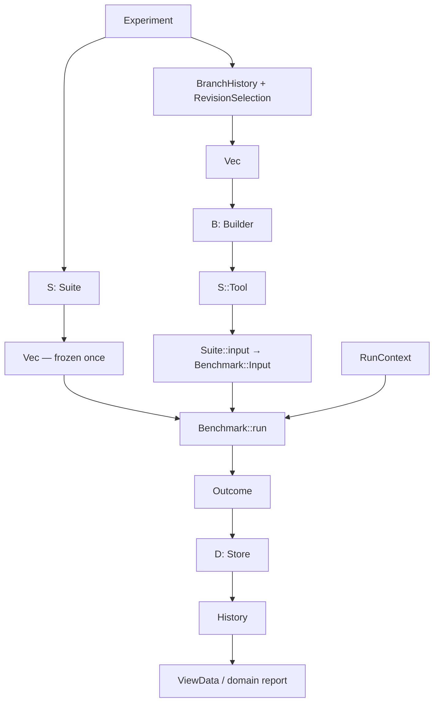

# Type hierarchy

The framework uses composition and traits with associated types. An experiment
freezes a suite of workloads, runs them against selected tool revisions, stores
typed outcomes, and projects those outcomes into views.

## What the main concepts mean

An **experiment** is one investigation into how a tool behaves under a fixed
testing plan. It answers a question such as “How did Yosys's MCM runtime and
synthesis quality change over these commits?” It defines the revisions and test
coverage needed to make that comparison meaningful.

A **suite** defines the set of problems used to investigate that question and
the settings they share. For MCM, that could be 40 generated coefficient sets,
all using 32-bit inputs and the same cell library. Those actual problems are
chosen once and reused at every commit.

A **benchmark** is a repeatable test recipe for one concrete problem. For MCM,
one benchmark might ask how Yosys handles `[-11, 17, 31]`: run the MCM pass,
compare it with the paper implementation, and synthesize with and without MCM.
It defines the work and how its results are measured.

For that example, the **workload** is the coefficient set and its settings. An
**attempt** is one execution of the benchmark against one Yosys commit. That
attempt can contain several repetitions of each measured procedure.

## Execution flow



The outer loop walks commits; the inner loop walks the same frozen benchmarks.
The builder runs once per commit, the suite binds runtime input once per commit,
and each benchmark controls its own subprocesses and repetitions.

## Core contracts

| Type                                       | High-level overview                                                                                                                                                    | Responsibility                                                                                                                                                  |
| ------------------------------------------ | ---------------------------------------------------------------------------------------------------------------------------------------------------------------------- | --------------------------------------------------------------------------------------------------------------------------------------------------------------- |
| [`Experiment<S>`](src/experiment.rs)       | One investigation of tool behavior across revisions, using a fixed testing plan. For example, tracking MCM performance over Yosys history.                             | Contains branch history, revision selection, suite, and artifact policy. The `run` function coordinates execution and returns an `ExperimentId`.                |
| [`Builder`](src/build/mod.rs)              | Obtains the exact program version to test, so each measurement corresponds to the intended revision.                                                                   | Turns a `Commit` into its associated `Tool`, including build/cache handling.                                                                                    |
| [`Suite`](src/suite.rs)                    | Defines which problems to test and their shared settings. For example, choosing 40 coefficient sets to cover a range of MCM problems.                                  | `benchmarks()` expands configuration into concrete benchmarks. `input(&Tool)` binds the current installation and supporting tools into benchmark runtime input. |
| [`Benchmark`](src/benchmark/mod.rs)        | A repeatable test recipe for one concrete problem, including the related procedures needed to compare its results.                                                     | Defines associated `Input` and `Output`, procedure `kind`/`version`, and execution through `RunContext`. Owns parsing and repetition strategy.                  |
| [`ReferenceCache`](src/store/reference.rs) | Remembers comparison results that remain applicable when the tested tool revision changes. For MCM, the paper tool can supply the same reference across Yosys commits. | Retrieves typed references by key and inserts immutable reference snapshots.                                                                                    |
| [`Store`](src/store/mod.rs)                | The durable experiment record: what was tested, with which revisions/settings, and what happened. Supports inspecting and comparing results later.                     | Extends `ReferenceCache`; registers definitions, starts/finishes attempts, records build failures, tracks completion, and queries typed history.                |
| [`View`](src/view.rs)                      | Defines how measurements answer a particular question. For example, turning MCM timings into runtime ratios or synthesis areas into percentage savings.                | Converts `History<Self::Output>` and a domain `Selection` into frontend-independent `ViewData`.                                                                 |

The same benchmark definition is used at several commits; each execution gets a
separate attempt record. The definition carries the problem and settings, its
runtime `Input` supplies the available tools, and its `Output` contains the
observations collected during that execution.

### Traits and their associated types

| Associated type     | High-level overview                                                                                                                      | MCM example                                                                                                            |
| ------------------- | ---------------------------------------------------------------------------------------------------------------------------------------- | ---------------------------------------------------------------------------------------------------------------------- |
| `Builder::Tool`     | What the builder hands back when the requested program version is ready to use.                                                          | `Yosys`: paths to a built executable and its supporting data, tied to a commit.                                        |
| `Suite::Tool`       | The revision-specific tool the suite needs to make its tests runnable. The experiment requires the builder to produce this same type.    | `Yosys`: the installation against which every coefficient set will be tested.                                          |
| `Suite::Benchmark`  | The concrete test-recipe type produced when this suite chooses its problems. Each returned value describes one problem and its settings. | `McmBenchmark`: one coefficient set, input width, library, options, and repetition count.                              |
| `Benchmark::Input`  | Runtime resources supplied when executing the recipe. The benchmark value itself already carries the frozen problem/settings.            | `McmInput`: this commit's Yosys installation together with the paper-tool executable.                                  |
| `Benchmark::Output` | The structured observations collected by a successful execution. This is the domain data saved for later analysis.                       | `McmOutput`: MCM timings/counts, the paper reference, and synthesis observations with and without MCM.                 |
| `View::Output`      | The stored measurement type that this view knows how to interpret. The view reads a `History` of these values.                           | `McmOutput`: `McmView` understands its timings, operation counts, and areas. The projection it produces is `ViewData`. |
| `View::Selection`   | The question or choice to apply when interpreting those measurements. It lets the same stored results answer different questions.        | `McmSelection`: choose a runtime-ratio or area-savings projection.                                                     |

`Suite::Benchmark` names a concrete type such as `McmBenchmark`; the `Benchmark`
trait describes the execution behavior that type must provide. Similarly,
`View::Output` names the measurements being interpreted, while `project()` returns
the derived presentation data.

For MCM, these choices describe a complete handoff: the builder provides a
`Yosys`; the suite supplies it alongside `PaperTool` as `McmInput`; each
`McmBenchmark` applies its frozen coefficient problem and produces `McmOutput`.
Later, `McmView` reads those outputs and uses `McmSelection` to compute a series.

### Generic parameters and persistence

`Store` and `ReferenceCache` support many payload types through generic methods.
For example, `history::<McmOutput>()` loads MCM measurements, while a synthesis
query can load `Samples<SynthStats>` from the same backend. A store implementation
therefore serves several benchmark families without choosing one associated
output type.

`RunContext<C>` chooses its reference-cache implementation, such as `SqliteStore`.
`History<O>`, `RunRecord<O>`, and `Outcome<O>` carry a chosen measurement type.
`Samples<T>` carries repeated observations, and `Reference<T>` carries a cached
value. These generic containers describe how values are held and managed.

Suites and benchmark definitions can be serialized so the testing plan can be
saved. Benchmark outputs support saving and loading so analysis can happen later.
Tool handles and runtime inputs can contain resources needed only during execution;
the framework does not require them to be serializable.

### How the contracts connect

The generic connections are enforced by these relationships:

```text
S: Suite
S::Benchmark: Benchmark
B: Builder<Tool = S::Tool>
S::input(&S::Tool) -> <S::Benchmark as Benchmark>::Input
Benchmark::run(&Input, &mut RunContext<C>) -> Result<Output>
D: Store + ReferenceCache
View::Output = the output type loaded from storage
```

The `D: Store` bound already includes `ReferenceCache`; both names above show the
backend's shared role. The current framework uses static dispatch through generic
functions.

## Revision selection and building

Sources: [history.rs](src/history.rs), [build/yosys.rs](src/build/yosys.rs).

| Type                | Meaning                                                                                                                |
| ------------------- | ---------------------------------------------------------------------------------------------------------------------- |
| `BranchHistory`     | Repository path and branch/ref whose first-parent history is selected.                                                 |
| `RevisionSelection` | `Explicit(Vec<CommitId>)` preserves requested order; `Since(CommitId)` selects commits after the anchor, oldest first. |
| `CommitId`          | String wrapper for a revision identity. Resolution normalizes selections into full commit IDs before building.         |
| `Commit`            | Resolved identity plus committer time, author, and full commit message.                                                |
| `YosysBuilder`      | Concrete `Builder<Tool = Yosys>`. Holds repository/cache paths and builds isolated, validated installations.           |
| `Yosys`             | Runtime installation handle: commit ID, executable path, and data-directory path.                                      |

Build cache entries belong to a repository and build recipe. Building finishes
before benchmark measurements begin; source worktree edits are excluded.

## Runtime context and observations

Sources: [benchmark/mod.rs](src/benchmark/mod.rs),
[benchmark/context.rs](src/benchmark/context.rs).

| Type                | Meaning                                                                                                                             |
| ------------------- | ----------------------------------------------------------------------------------------------------------------------------------- |
| `RunContext<'a, C>` | Per-attempt workspace and helpers. Borrows `&'a mut C` for reference access; carries artifact settings and a reference-reuse scope. |
| `ArtifactPolicy`    | Independent `logs`, `scripts`, and `netlists` retention flags, all off by default.                                                  |
| `ProcessOutput`     | Captured subprocess output plus elapsed wall-clock duration.                                                                        |
| `Samples<T>`        | Individual observations for one procedure/workload. Preserves repetitions instead of replacing them with an average.                |

The experiment gives MCM contexts an experiment-specific reference scope. Paper
observations can be reused across that experiment's Yosys commits. Unscoped
contexts collect fresh references. Process timing covers spawn through output
collection; preparation, parsing, and subsequent log writing happen outside it.

## MCM specialization

Sources: [mcm/mod.rs](src/benchmarks/mcm/mod.rs),
[generate.rs](src/benchmarks/mcm/generate.rs),
[output.rs](src/benchmarks/mcm/output.rs).

| Type                   | Corresponds to                                                                                                                                                                     |
| ---------------------- | ---------------------------------------------------------------------------------------------------------------------------------------------------------------------------------- |
| `McmSuite`             | Sweep configuration: coefficient sets/generator, input width, cell library, paper tool, options, and repetition count. Implements `Suite<Tool = Yosys, Benchmark = McmBenchmark>`. |
| `CoefficientSets`      | Workload source: `Explicit(Vec<Vec<i64>>)` or `Generated(CoefficientGenerator)`.                                                                                                   |
| `CoefficientGenerator` | Seeded Pareto distribution settings: seed, count, length/value ranges, shape, and scale. Defaults reproduce the Python reference's 40 coefficient sets.                            |
| `McmBenchmark`         | One frozen ordered coefficient set and its width, library, options, and repetitions. This is the serializable workload definition.                                                 |
| `McmOptions`           | MCM depth/search budget and paper-tool seed/bit-width settings.                                                                                                                    |
| `PaperTool`            | Runtime executable handle for the independent paper implementation.                                                                                                                |
| `McmInput`             | Runtime tools for one commit: the built `Yosys` and fixed `PaperTool`.                                                                                                             |
| `McmOutput`            | Successful complete comparison, containing all observations from the four procedures below.                                                                                        |
| `YosysStats`           | One MCM observation: duration, add/sub count, negations, remaining multipliers, and optional depth.                                                                                |
| `PaperStats`           | One paper observation: duration, add/sub count, shifts, negations, remaining multipliers, and depth.                                                                               |

```text
McmBenchmark::Input  = McmInput
McmBenchmark::Output = McmOutput

McmOutput
├── yosys_mcm:        Samples<YosysStats>
├── paper:            Reference<Samples<PaperStats>>
├── synth_without_mcm: Samples<SynthStats>
└── synth_with_mcm:    Samples<SynthStats>
```

The workload configuration, runtime tool handles, and measured output are
separate values. One `McmBenchmark` owns the entire comparison: MCM profiling,
paper reference acquisition, and synthesis without/with MCM. The suite generates
coefficients once; storage freezes actual coefficient values alongside settings.

## Storage and attempt lifecycle

Sources: [store/mod.rs](src/store/mod.rs), [reference.rs](src/store/reference.rs),
[sqlite.rs](src/store/sqlite.rs).

| Type                   | Meaning                                                                                                                                                           |
| ---------------------- | ----------------------------------------------------------------------------------------------------------------------------------------------------------------- |
| `SqliteStore`          | Concrete implementation of both `Store` and `ReferenceCache`. Persists common metadata relationally and domain payloads as JSON.                                  |
| `ExperimentDefinition` | Frozen serialized configuration, ordered benchmark definitions, and ordered commits.                                                                              |
| `BenchmarkDefinition`  | Procedure kind/version and serialized workload parameters.                                                                                                        |
| `RunStart`             | Durable attempt-start metadata: experiment, commit, workload position/definition, start time, purpose, and optional artifact path.                                |
| `RunRecord<O>`         | Finished attempt metadata plus finish time and `Outcome<O>`.                                                                                                      |
| `RunPurpose`           | `Measurement`, or `Inspection { source: RecordId }` linking a diagnostic attempt to its source measurement.                                                       |
| `Outcome<O>`           | `Succeeded(O)`, `Failed(String)`, or `Unsupported(String)`.                                                                                                       |
| `HistoryQuery`         | Selects an experiment, benchmark kind/version, and optional exact parameter filter.                                                                               |
| `History<O>`           | Selected commits in frozen order, matching benchmark definitions by original position, and selected finished records. Includes metadata for missing measurements. |
| `HistoryEntry<O>`      | A storage-assigned record ID paired with its `RunRecord<O>`.                                                                                                      |
| `Reference<T>`         | Immutable reference snapshot: ID, value, and measurement timestamp. MCM embeds the snapshot in its output.                                                        |
| `ExperimentId`         | `i64` alias identifying a registered experiment.                                                                                                                  |
| `RecordId`             | `i64` alias identifying an execution attempt.                                                                                                                     |
| `ReferenceId`          | `i64` alias identifying an immutable cached reference.                                                                                                            |

A workload's position distinguishes duplicate definitions. SQLite history picks
the latest finished measurement per commit/workload and excludes inspections.
A pending retry leaves the previous finished measurement queryable. Commit
completion requires terminal outcomes for every workload and a completed prefix;
failed/unsupported outcomes count as processed. Build failures and unfinished
attempts leave the affected commit incomplete.

## Views and reports

Sources: [view.rs](src/view.rs), [mcm/view.rs](src/benchmarks/mcm/view.rs),
[mcm/report.rs](src/benchmarks/mcm/report.rs).

| Type                 | Meaning                                                                                                                                     |
| -------------------- | ------------------------------------------------------------------------------------------------------------------------------------------- |
| `ViewData`           | Collection of scalar series for a frontend; also supports text display and JSON serialization.                                              |
| `Series`             | Metric label, unit, and ordered points.                                                                                                     |
| `Point`              | Commit ID, optional numeric value, and coverage.                                                                                            |
| `Coverage`           | Included/selected workload counts and explicit exclusions.                                                                                  |
| `ExcludedWorkload`   | Original workload position and exclusion reason.                                                                                            |
| `McmView`            | Implements `View<Output = McmOutput, Selection = McmSelection>` and additionally produces a detailed `McmReport`.                           |
| `McmSelection`       | Selects an `McmMetric`. Workload filtering is available through `HistoryQuery`.                                                             |
| `McmMetric`          | `RuntimeRatio` or `AreaSavings`.                                                                                                            |
| `McmReport`          | Detailed reports for all selected commits.                                                                                                  |
| `McmCommitReport`    | Commit identity, per-workload reports, and aggregate `McmSummary`.                                                                          |
| `McmWorkloadReport`  | Workload index, optional decoded coefficients, and optional `Outcome<McmWorkloadSummary>`. An absent outcome means no finished measurement. |
| `McmWorkloadSummary` | Per-tool summaries, reference ID, areas/ratios, quality comparison, and notes for unavailable metrics.                                      |
| `ToolSummary`        | Mean operation counts/depth and timing summary for one tool/workload.                                                                       |
| `TimingSummary`      | Sample count, optional mean in milliseconds, and optional sample standard deviation.                                                        |
| `McmSummary`         | Across-workload runtime statistics, runtime ratio, quality counts, area comparisons/savings, and coverage.                                  |
| `Quality`            | `Better`, `Same`, or `Worse`: fewer remaining multipliers wins, then fewer add/sub operations.                                              |
| `ComparisonCounts`   | Counts of better/same/worse workloads and excluded comparisons.                                                                             |

`ToolSummary::timing` describes repetitions within one workload.
`McmSummary` timing describes the distribution of workload means. Both use sample
standard deviation (`n - 1`), absent below two observations. Runtime ratio divides
matched workload means; area savings averages workload savings. Missing or invalid
measurements remain visible through absent values and exclusions.

## File-based synthesis specialization

Sources: [design.rs](src/design.rs), [benchmarks/synth.rs](src/benchmarks/synth.rs).

| Type             | Meaning                                                                                                         |
| ---------------- | --------------------------------------------------------------------------------------------------------------- |
| `VerilogDesign`  | Prepared top module, ordered source files, include directories, and defines.                                    |
| `SourceFile`     | Source path paired with a `SourceLanguage`.                                                                     |
| `SourceLanguage` | `Verilog` or `SystemVerilog`.                                                                                   |
| `CellLibrary`    | Library name and Liberty file path. Shared by MCM and synthesis benchmarks.                                     |
| `SynthSuite`     | Expands designs × cell libraries into `SynthBenchmark` values; binds `Yosys` as runtime input.                  |
| `SynthBenchmark` | One design/library/options/repetition combination. Its execution is still a stub.                               |
| `SynthOptions`   | Additional synthesis pass settings.                                                                             |
| `SynthStats`     | One synthesis observation: duration, cell count, and optional area. Already produced by MCM's synthesis phases. |

`SynthBenchmark::Input = Yosys` and
`SynthBenchmark::Output = Samples<SynthStats>`.

## Errors and implementation helpers

| Type                    | Meaning                                                                                                                                    |
| ----------------------- | ------------------------------------------------------------------------------------------------------------------------------------------ |
| [`Error`](src/error.rs) | Shared `thiserror` enum for I/O, Git, builds, processes, parsing/benchmark, storage, view, unsupported, and unfinished-operation failures. |
| `Result<T>`             | Alias for `std::result::Result<T, Error>`.                                                                                                 |
| `CacheIdentity`         | Private Yosys cache ownership/recipe metadata.                                                                                             |
| `BuildLog`              | Private persistent build-command log and failure context.                                                                                  |
| `RawRun`                | Private SQLite row-decoding intermediate.                                                                                                  |
| `PaperKey`              | Private MCM reference key containing tool digest, workload/settings, and measurement scope.                                                |
| `PythonRandom`          | Private adapter over MT19937 preserving Python-compatible seed encoding and random draw order.                                             |
| `Options`               | Private `view_results` CLI configuration: database, experiment, metrics, detail mode, and JSON/text output.                                |

The MCM path is implemented through execution, persistence, scalar views, and
detailed reports. The generic synthesis executor, automatic resume, general input
digest verification, process timeouts, and graphical frontend remain deferred.
